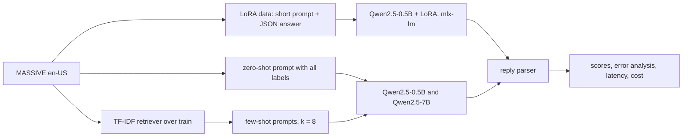

<h1 align="center">Fine-tune vs. Prompt a Small LLM</h1>

<p align="center">
  <a href="https://github.com/haroonkhan02/llm-finetune-vs-prompt/actions/workflows/ci.yml"></a>
  
  
  
</p>

When is it worth fine-tuning a small model instead of prompting a bigger one? This project
answers that for one narrow task: turning a voice-assistant request into an intent and its
slots, as JSON. I compare a LoRA-tuned 0.5B model on Apple silicon (MLX) with the same
model prompted zero-shot and few-shot, and with a 7B model, on quality, latency and cost
per 1,000 requests.

```text
"wake me up at five am this week"
→ {"intent": "alarm_set", "slots": [["time", "five am"], ["date", "this week"]]}
```

## What it does

- Downloads Amazon MASSIVE (English), builds zero-shot, retrieved few-shot and fine-tuning prompts.
- Trains a LoRA adapter on Qwen2.5-0.5B-Instruct with `mlx-lm` in about 15 minutes on an M5.
- Runs every system on the same 1,000 test utterances and stores each reply, so scores can be recomputed without the model.
- Scores intent accuracy, slot F1 and exact match with bootstrap intervals, breaks the errors down by kind, and estimates cost per 1,000 requests.



## Results

All systems on the same 1,000 test utterances, greedy decoding, one request at a time on an
Apple M5. Intervals and the training curve: [`reports/results.md`](reports/results.md).

| System | Intent acc | Slot F1 | Exact match | Input tokens | Latency p50 |
|---|---:|---:|---:|---:|---:|
| Nearest training utterance (no LLM) | 73.5 % | – | – | – | – |
| Qwen2.5-0.5B zero-shot | 26.8 % | 6.7 % | 0.9 % | 529 | 0.28 s |
| Qwen2.5-0.5B few-shot (k = 8) | 77.4 % | 58.8 % | 47.9 % | 797 | 0.24 s |
| Qwen2.5-0.5B + LoRA | 83.1 % | 70.9 % | 60.6 % | 33 | 0.26 s |
| Qwen2.5-7B zero-shot (4-bit) | 67.4 % | 30.6 % | 22.6 % | 529 | 1.34 s |
| Qwen2.5-7B few-shot (4-bit) | 87.5 % | 71.4 % | 63.8 % | 797 | 1.57 s |

Fifteen minutes of LoRA training take the 0.5B model from unusable to the level of a 7B
model prompted with retrieved examples on slots (paired difference 0.5 points, CI −2.6 to
3.9), at about a sixth of the latency. The 7B model stays ahead on exact match by 3.2
points (CI 0.1 to 6.2), and that gap is almost entirely intent errors. Zero-shot, the 0.5B
model invents intent names in about a third of its replies; the tuned model never does.

The tuned model can be made faster without retraining
([`reports/fused.md`](reports/fused.md)):

| LoRA variant | On disk | Exact match | Latency p50 |
|---|---:|---:|---:|
| Adapter on the bf16 base | 34 MB + base | 60.6 % | 0.26 s |
| Adapter fused into the weights (bf16) | 953 MB | 60.0 % | 0.22 s |
| Fused, then quantised to 4-bit | 276 MB | 54.8 % | 0.08 s |

Fusing removes the extra adapter matmuls from every decoding step; the 0.6-point change is
within noise (CI −1.3 to 0.1). The 4-bit copy, at the same precision as the 7B model, is
20 times faster than 7B few-shot but loses 5.8 points of exact match (CI −8.3 to −3.4),
mostly on slots. An unfused rerun gave identical scores, so these are not run-to-run noise.

### Where the errors are

From [`reports/error_analysis.md`](reports/error_analysis.md) and
[`reports/label_audit.md`](reports/label_audit.md):

- The tuned model's slot mistakes are mostly boundaries ("the fifteenth of march" vs
  "fifteenth of march") and missed or extra slots. It almost never invents a value (4 cases).
- Both strong systems confuse MASSIVE's catch-all `general_quirky` with `qa_factoid`, and
  `calendar_set` with `calendar_query`.
- They give the same non-gold answer on 71 utterances. Reading all 71, I counted 13 where
  the gold label looks wrong or the request is unlabelable ("s.", "fast"), 43 that are
  defensible under a different convention ("green and red" as one slot or two), and 15
  real model mistakes. Exact match therefore has a ceiling well below 100 % on this data.

### Cost per 1,000 requests

| System | Input tokens | M5 time | Same prompts on Claude Haiku 5.5 / Sonnet 5.5 / Opus 5.5 |
|---|---:|---:|---:|
| 0.5B + LoRA | 33 k | 4.5 min | not applicable (needs the tuned weights) |
| 0.5B + LoRA, fused 4-bit | 33 k | 1.4 min | not applicable |
| 0.5B few-shot | 804 k | 4.4 min | $0.09 / $1.81 / $3.61 |
| 7B few-shot | 804 k | 27 min | $0.09 / $1.82 / $3.63 |

The hosted prices are an estimate from list prices and Qwen token counts, without prompt
caching. The fine-tuned model needs 24 times fewer input tokens; on local hardware that
barely shows as time, because decoding about 20 output tokens dominates. Details in
[`reports/cost.md`](reports/cost.md).

## Getting started

```bash
uv venv --python 3.12 && source .venv/bin/activate
uv pip install -e ".[dev,mlx]"
ftvp-download      # MASSIVE 1.1 archive (40 MB), keeps only en-US
ftvp-prepare       # data/sft/{train,valid,test}.jsonl for mlx_lm.lora
python -m mlx_lm lora -c configs/lora.yaml | tee outputs/train.log   # ~15 min on an M5
scripts/run_all.sh # five systems x 1,000 requests, then ftvp-report
scripts/run_fused.sh                       # fused and 4-bit fused adapter timing
ftvp-errors qwen05b-zero qwen05b-few qwen05b-lora qwen7b-zero qwen7b-few --pair qwen05b-lora qwen7b-few
ftvp-cost qwen05b-zero qwen05b-few qwen05b-lora qwen7b-zero qwen7b-few
pytest -q
```

The scoring commands read the committed runs in `reports/runs/`, so `ftvp-errors`,
`ftvp-cost` and `ftvp-report --runs-dir reports/runs` work without downloading any model.
A Claude few-shot run (`ftvp-run --backend anthropic:claude-opus-5-5`) requires an
Anthropic API key and has not been run.

## Repository structure

```text
llm-finetune-vs-prompt/
├── configs/default.yaml     # dataset URL + checksum, eval subset, k, SFT split sizes
├── configs/lora.yaml        # LoRA hyperparameters for mlx_lm.lora
├── src/ftvp/
│   ├── download.py          # resumable download, checksum, extracts one locale
│   ├── massive.py           # annotated utterance -> intent + (type, value) slots
│   ├── schema.py            # target JSON and a tolerant reply parser
│   ├── metrics.py           # intent / slot / exact-match scores, bootstrap CIs
│   ├── prompts.py           # zero-shot, retrieved few-shot, fine-tuned prompts
│   ├── sft.py, check.py     # mlx-lm training data, data checks
│   ├── backends.py          # MLX (+ LoRA adapter), Anthropic, fake
│   ├── runner.py            # resumable runs, one JSON record per request
│   ├── report.py            # scores, intervals, paired comparison, training curve
│   ├── errors.py            # error kinds, confusions, per-type F1, run overlap
│   └── cost.py              # cost per 1,000 requests
├── scripts/                 # run_all.sh, run_fused.sh
├── reports/                 # results, error analysis, label audit, cost, compact runs
└── tests/                   # synthetic fixtures, no data or model needed
```

## Design decisions

| Decision | Why |
|---|---|
| Few-shot examples retrieved by similarity | a strong prompting baseline; a weak one would flatter fine-tuning |
| Loss on the answer only (`mask_prompt`) | the model should learn the labels, not the requests |
| Warmup + cosine learning rate | a constant 1e-4 made the first steps worse than the base model |
| Slots as `[type, value]` pairs, value-level F1 | repeated types are common; a generative model returns strings, not spans |
| Parser forgives fences and prose, but records it | format compliance is a result, not a crash |
| Paired bootstrap on the same utterances | differences of a few points need intervals, not point estimates |
| Runs stored per request, re-scored from text | a parser or metric fix never needs another model run |

## Limitations and next steps

- One task, one language, one model family; 1,000 test utterances give intervals of about ±3 points.
- The 7B model is 4-bit and the 0.5B model bf16, so speed is not a like-for-like hardware comparison.
- Latency is batch size 1 on a laptop; a server with batching would change the cost picture.
- The label audit is one person's reading, not a second annotation.
- Next: constrained JSON decoding, a LoRA on the 7B model, distilling the 7B few-shot answers into the 0.5B model, and a Claude few-shot run.

## License

MIT for the code. MASSIVE is © Amazon, CC BY 4.0.
