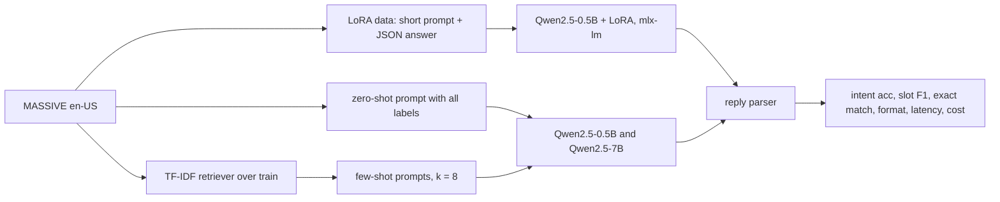

<h1 align="center">Fine-tune vs. Prompt a Small LLM</h1>

<p align="center">
  <a href="https://github.com/haroonkhan02/llm-finetune-vs-prompt/actions/workflows/ci.yml"></a>
  
  
  
</p>

When is it worth fine-tuning a small model instead of prompting a bigger one? This project
answers that for one narrow task: turning a voice-assistant request into an intent and its
slots, as JSON. I compare a LoRA-tuned 0.5B model on Apple silicon (MLX) with the same
model prompted zero-shot and few-shot, and with a 7B model, on quality, latency and cost
per 1,000 requests.

```text
"wake me up at five am this week"
→ {"intent": "alarm_set", "slots": [["time", "five am"], ["date", "this week"]]}
```

**Status: work in progress.** The data pipeline, output parser, metrics, prompts and the
LoRA training data are done and tested. Training, the model runs and the comparison come
next; no model results yet.

## Task and data

[MASSIVE](https://github.com/alexa/massive) 1.1 (Amazon, CC BY 4.0), English only: 11,514
train, 2,033 dev and 2,974 test utterances, 60 intents and 55 slot types. A third of the
requests have no slot, and about 3 % repeat a slot type ("on monday and on friday"), so
slots are a list of pairs, not a dict. Every system is scored on the same seeded subset of
1,000 test utterances.

From [`reports/data_check.md`](reports/data_check.md):

| Check | Value |
|---|---:|
| Intent of the nearest training utterance (TF-IDF 1-NN, no LLM) | 73.5 % |
| Gold intent among the 8 retrieved few-shot examples | 91.7 % |
| Prompt tokens per request: zero-shot / few-shot (k=8) / fine-tuned | 529 / 797 / 33 |

The 1-NN figure is the floor every model has to beat. The prompt lengths are the main cost
argument for fine-tuning: the tuned model learns the label list and the format, so it does
not pay for them on every request.

## Planned comparison



| System | Model | Prompt |
|---|---|---|
| Retrieval baseline | none | intent of the nearest train utterance |
| Zero-shot | Qwen2.5-0.5B-Instruct, Qwen2.5-7B-Instruct | instructions + all labels |
| Few-shot | same two | + 8 nearest training examples as chat turns |
| Fine-tuned | Qwen2.5-0.5B-Instruct + LoRA | one-line instruction |
| API model (optional) | Claude | few-shot; requires an Anthropic API key |

Metrics: intent accuracy, slot precision/recall/F1 on (type, value) pairs, exact match,
valid-JSON and exact-schema rates, share of slot values copied from the utterance, median
and p95 latency on an M5, and cost per 1,000 requests. Differences between systems get
paired bootstrap intervals.

## Getting started

```bash
uv venv --python 3.12 && source .venv/bin/activate
uv pip install -e ".[dev,mlx]"
ftvp-download      # MASSIVE 1.1 archive (40 MB), keeps only en-US
ftvp-check --tokenizer mlx-community/Qwen2.5-0.5B-Instruct-4bit
ftvp-prepare       # data/sft/{train,valid,test}.jsonl for mlx_lm.lora
pytest -q
```

## Repository structure

```text
llm-finetune-vs-prompt/
├── configs/default.yaml     # dataset URL + checksum, eval subset, k, SFT split sizes
├── src/ftvp/
│   ├── download.py          # resumable download, checksum, extracts one locale
│   ├── massive.py           # annotated utterance -> intent + (type, value) slots
│   ├── schema.py            # target JSON and a tolerant reply parser
│   ├── metrics.py           # intent / slot / exact-match scores, bootstrap CIs
│   ├── prompts.py           # zero-shot, retrieved few-shot, fine-tuned prompts
│   ├── sft.py               # mlx-lm chat-format training data
│   └── check.py             # data stats, retrieval baseline, prompt lengths
├── reports/                 # generated reports
└── tests/                   # synthetic fixtures, no data or model needed
```

## Design decisions

| Decision | Why |
|---|---|
| Slots as `[type, value]` pairs | repeated types are common enough to matter |
| Value-level slot F1 | a generative model returns strings, not token spans |
| Parser forgives fences and prose, but records it | format compliance is a result, not a crash |
| Few-shot examples retrieved by similarity | a stronger prompting baseline than fixed examples |
| Same tokenizer family for 0.5B and 7B | prompt costs are directly comparable |

## License

MIT for the code. MASSIVE is © Amazon, CC BY 4.0.
